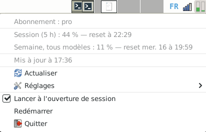

# usclaude

*[English version](README.md)*

Petite applet Linux qui affiche les limites d'usage de
[Claude Code](https://claude.com/claude-code), [Codex](https://github.com/openai/codex)
et [Kimi Code](https://github.com/MoonshotAI/kimi-code) dans **trois icônes indépendantes**
de la zone de notification.



Chaque icône contient deux grandes jauges : **session de 5 heures** et **semaine** pour
Claude/Codex, **session de 5 heures** et **mois** pour Kimi. Les jauges sont vertes sous 50 %, orange
sous 80 %, rouges au-delà. Le menu indique aussi l'heure de remise à zéro de chaque limite.
Les icônes sont fournies en 32, 48, 64 et 128 pixels ; leur taille réelle dépend du panneau.

Utiliser `usclaude` ou `usclaude --claude` pour Claude, `usclaude --codex` pour Codex et
`usclaude --kimi` pour Kimi. Pour lancer les trois manuellement :

```sh
usclaude --claude &
usclaude --codex &
usclaude --kimi &
```

Chaque applet possède ses réglages, son cache et son entrée **Lancer à l'ouverture de
session**. Activer cette entrée dans chacune pour retrouver les trois icônes au démarrage.

Écrit en Rust avec [ksni](https://github.com/iovxw/ksni) (protocole
StatusNotifierItem, sans GTK). Un seul binaire statique, sans aucune dépendance.

> Projet indépendant, non affilié à Anthropic, OpenAI ou Moonshot AI.

## Prérequis

- **Claude Code connecté avec un compte claude.ai** (Pro ou Max), c'est-à-dire via
  `/login`. Une clé d'API n'a pas de limites `/usage` à afficher.
- **Codex et/ou Kimi Code connectés** pour leurs icônes respectives. Une connexion
  manquante n'empêche pas les autres applets de fonctionner.
- **Un panneau compatible StatusNotifierItem**, le protocole standard des icônes de
  notification. X11 ou Wayland ne change rien.

## Compatibilité

| Bureau | Prise en charge |
| --- | --- |
| KDE Plasma | ✅ native |
| XFCE 4.16 et plus récent | ✅ greffon *Zone de notification* (testé sur XFCE 4.20) |
| LXQt, Cinnamon | ✅ native |
| GNOME sous Ubuntu | ✅ extension AppIndicator installée d'office |
| GNOME ailleurs (Debian, Fedora…) | ⚠️ installer l'extension *AppIndicator and KStatusNotifierItem Support* |
| MATE, Budgie | ⚠️ selon la version et l'applet de notification utilisée |
| Sway, Hyprland… avec waybar | ✅ si le module `tray` est activé |
| i3bar, polybar, LXDE | ❌ ne gèrent que l'ancien protocole XEmbed |

Seul XFCE 4.20 a été testé ; le reste s'appuie sur la prise en charge annoncée par
chaque bureau.

Sans zone de notification compatible, l'applet ne s'arrête pas : elle l'indique dans
le terminal et patiente. L'icône apparaît dès que le panneau est prêt, ce qui couvre
aussi le démarrage de session, quand l'applet se lance avant le panneau, et le
redémarrage du panneau.

## Installation

Depuis la [dernière version publiée](https://github.com/niqoz/usclaude/releases/latest).

**Debian, Ubuntu, Linux Mint** :

```sh
sudo apt install ./usclaude_0.2.3_amd64.deb
```

L'applet s'ajoute au menu, dans **Accessoires**, et se lance aussi en tapant
`usclaude`.

**Autres distributions** (x86_64) : binaire statique, sans aucune dépendance.

```sh
tar xzf usclaude-0.2.3-x86_64-linux.tar.gz
install -m 755 usclaude-0.2.3-x86_64-linux/usclaude ~/.local/bin/
usclaude &
```

**Depuis les sources** (Rust 1.89 ou plus récent) :

```sh
cargo install --git https://github.com/niqoz/usclaude
```

Pour qu'elle démarre avec la session, cocher **Lancer à l'ouverture de session**
dans son menu.

## Menu

| Entrée | Rôle |
| --- | --- |
| Limites | Pourcentage utilisé et remise à zéro de chaque limite du service. |
| Actualiser | Nouvelle mesure immédiate. |
| Réglages | Intervalle de rafraîchissement : 90 s, 3 min, 5 min ou 10 min. |
| Lancer à l'ouverture de session | Crée ou supprime l'entrée de démarrage automatique. |
| Redémarrer | Relance l'applet, par exemple après une mise à jour du binaire. |
| Quitter | Arrête l'applet. |

Une seule instance par service tourne à la fois : un second lancement du même service
s'arrête aussitôt, tandis que Claude, Codex et Kimi peuvent fonctionner simultanément.
À la fermeture de session, chaque applet s'arrête avec le bus D-Bus, pour laisser la
place à celle de la session suivante.

## Fonctionnement

Pour Claude, l'applet interroge le même service que `/usage`
(`https://api.anthropic.com/api/oauth/usage`) avec le jeton de connexion de Claude
Code, lu dans `~/.claude/.credentials.json` (ou `$CLAUDE_CONFIG_DIR`).

Ce jeton expire au bout de quelques heures, et Claude Code ne le renouvelle que
lorsqu'on s'en sert : utiliser seulement Claude Desktop ne suffit pas. Une fois le
jeton expiré, l'applet le rafraîchit donc elle-même, comme le ferait Claude Code, et
réécrit le fichier. Elle prend pour cela le même verrou que Claude Code
(`~/.claude.lock`), pour que les deux ne rafraîchissent jamais en même temps : le
jeton de rafraîchissement ne sert qu'une fois. Si la connexion elle-même a expiré,
l'applet demande de relancer `claude` puis `/login`.
Aucune autre donnée n'est envoyée ni conservée.

Fichiers utilisés :

| Fichier | Usage |
| --- | --- |
| `~/.claude/.credentials.json` | Jeton de connexion, réécrit après rafraîchissement. |
| `~/.config/usclaude/interval` | Intervalle choisi, en secondes. |
| `~/.cache/usclaude/last.json` | Dernière réponse valide, réaffichée au démarrage. |
| `~/.config/autostart/usclaude.desktop` | Démarrage automatique, si activé. |
| `$XDG_RUNTIME_DIR/usclaude-$USER.lock` | Verrou d'instance unique. |

## Codex

L'applet Codex possède deux grandes jauges au contour bleu et se lance avec
`usclaude --codex`. Les limites de
[Codex](https://github.com/openai/codex) d'un compte ChatGPT (session de 5 heures
et semaine) sont les mêmes que la commande `/status` de Codex. Contrairement aux
fichiers de session de Codex, les chiffres couvrent toute l'utilisation du compte,
quelle que soit la machine.

Le jeton est lu dans `~/.codex/auth.json` (ou `$CODEX_HOME`), et rafraîchi comme
pour Claude une fois expiré (au bout de 10 jours sans utiliser Codex) ; le
service interrogé est `https://chatgpt.com/backend-api/wham/usage`, lui aussi non
documenté. Cette instance a ses propres réglages, cache, verrou et démarrage
automatique, sous le nom `usclaude-codex`. `usclaude --codex --print` fonctionne
aussi.

Le paquet `.deb` ajoute aussi au menu une entrée individuelle **usclaude (Codex)**, à
côté de l'entrée Claude.

## Kimi Code

L'applet Kimi Code possède deux grandes jauges au contour violet et se lance avec
`usclaude --kimi`. Les deux jauges de
[Kimi Code](https://github.com/MoonshotAI/kimi-code) représentent la **session de 5
heures** et le **mois** ; le menu détaille aussi la semaine. Si le résumé d'une fenêtre et
son compteur détaillé se contredisent, la valeur la plus élevée est retenue.

Le service interrogé est `https://api.kimi.com/coding/v1/usages`. L'applet lit
`access_token` dans `~/.kimi-code/credentials/kimi-code.json` (ou `$KIMI_CODE_HOME`).
Pour y enregistrer une clé API de la console Kimi Code :

```json
{
  "access_token": "votre-clé"
}
```

Sans `expires_at`, cette clé est traitée comme une clé API longue durée. Un jeton OAuth du
CLI possède au contraire une échéance : il est relu à chaque mesure, mais n'est pas
rafraîchi par l'applet, pour ne pas entrer en conflit avec le CLI officiel. Lancer `kimi`
pour le renouveler. La variable `KIMI_CODE_API_KEY` reste une alternative prioritaire au
fichier.

`KIMI_CODE_BASE_URL` peut remplacer la base `https://api.kimi.com/coding/v1`, notamment
pour un compte international. Cette instance a ses propres réglages, cache, verrou et
démarrage automatique, sous le nom `usclaude-kimi`. `usclaude --kimi --print` fonctionne
aussi. Le paquet `.deb` ajoute de même une entrée individuelle **usclaude (Kimi Code)**.

## Diagnostic

```sh
usclaude --print
```

affiche une fois dans le terminal l'usage du service choisi (Claude par défaut), ou
l'erreur rencontrée. Utiliser `usclaude --codex --print` et `usclaude --kimi --print`
pour les deux autres services.

## Limites connues

- **Service non documenté** : l'adresse et le format de la réponse ne sont pas
  publics et peuvent changer sans préavis. Les limites inconnues sont affichées sous
  leur nom brut dès qu'elles dépassent 0 %.
- **Rafraîchissement fréquent** : le service peut répondre « trop de requêtes »
  (erreur 429). L'applet garde alors les dernières valeurs et attend le délai
  indiqué par le service (en-tête `Retry-After`, jusqu'à 1 h). S'il n'en indique
  pas, elle double son attente à chaque refus, jusqu'à 10 min. Elle revient à
  l'intervalle choisi dès qu'une réponse passe ; le menu indique l'heure du
  prochain essai.
- **Au démarrage**, l'applet réaffiche aussitôt les derniers chiffres connus, avec
  leur heure (« Mis à jour mer. 9 à 15:11 »), le temps que la première mesure
  aboutisse. Une erreur survenue depuis s'affiche sur sa propre ligne du menu.
- **Langue** : français si la langue du système l'est (`LANG=fr_…`), anglais sinon.
  Pour forcer l'anglais : `LANG=en_US.UTF-8 usclaude`.

## Tests

```sh
cargo test
cargo clippy --all-targets
```

## Fichiers de release

```sh
./packaging/build-release.sh
```

produit dans `target/dist/` l'archive `.tar.gz` et le paquet `.deb`, tous deux avec
un binaire statique (musl). Prérequis : la cible
`rustup target add x86_64-unknown-linux-musl`, et les paquets `musl-tools`,
`dpkg-dev` et `fakeroot`.
