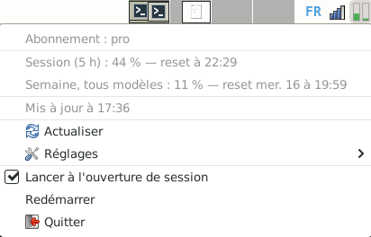

# usclaude

*[Version française](README.fr.md)*

A small Linux applet that shows the usage limits of
[Claude Code](https://claude.com/claude-code), [Codex](https://github.com/openai/codex)
and [Kimi Code](https://github.com/MoonshotAI/kimi-code) in **three independent system
tray icons**.



Each icon has two large gauges: **5-hour session** and **week** for Claude/Codex,
**5-hour session** and **month** for Kimi. Gauges are green below 50 %, orange below 80 %, and red above. The
menu also shows every limit's reset time. Icons are provided at 32, 48, 64 and 128 pixels;
their actual size depends on the panel setting.

Use `usclaude` or `usclaude --claude` for Claude, `usclaude --codex` for Codex and
`usclaude --kimi` for Kimi. To start all three manually:

```sh
usclaude --claude &
usclaude --codex &
usclaude --kimi &
```

Each applet has its own settings, cache and **Start at login** entry. Enable that entry in
each one to restore all three icons at session startup.

Written in Rust with [ksni](https://github.com/iovxw/ksni) (StatusNotifierItem
protocol, no GTK). A single static binary with no dependencies.

> Independent project, not affiliated with Anthropic, OpenAI or Moonshot AI. The interface
> is in English, or in French when the system language is French.

## Requirements

- **Claude Code signed in with a claude.ai account** (Pro or Max), i.e. via
  `/login`. An API key has no `/usage` limits to show.
- **Codex and/or Kimi Code signed in** for their respective icons. A missing sign-in
  does not prevent the other applets from working.
- **A panel that supports StatusNotifierItem**, the standard tray icon protocol.
  X11 or Wayland makes no difference.

## Compatibility

| Desktop | Support |
| --- | --- |
| KDE Plasma | ✅ native |
| XFCE 4.16 and later | ✅ *Status Tray* plugin (tested on XFCE 4.20) |
| LXQt, Cinnamon | ✅ native |
| GNOME on Ubuntu | ✅ AppIndicator extension installed by default |
| GNOME elsewhere (Debian, Fedora…) | ⚠️ install the *AppIndicator and KStatusNotifierItem Support* extension |
| MATE, Budgie | ⚠️ depends on the version and the tray applet in use |
| Sway, Hyprland… with waybar | ✅ if the `tray` module is enabled |
| i3bar, polybar, LXDE | ❌ only support the older XEmbed protocol |

Only XFCE 4.20 has been tested; the rest relies on each desktop's advertised
support.

Without a compatible tray, the applet does not quit: it says so in the terminal and
waits. The icon appears as soon as the panel is ready, which also covers session
startup (when the applet starts before the panel) and panel restarts.

## Installation

From the [latest release](https://github.com/niqoz/usclaude/releases/latest).

**Debian, Ubuntu, Linux Mint**:

```sh
sudo apt install ./usclaude_0.2.3_amd64.deb
```

The applet is added to the menu under **Accessories** and can also be started by
typing `usclaude`.

**Other distributions** (x86_64): static binary, no dependencies at all.

```sh
tar xzf usclaude-0.2.3-x86_64-linux.tar.gz
install -m 755 usclaude-0.2.3-x86_64-linux/usclaude ~/.local/bin/
usclaude &
```

**From source** (Rust 1.89 or later):

```sh
cargo install --git https://github.com/niqoz/usclaude
```

To start it with your session, tick **Start at login** in its menu.

## Menu

| Entry | Meaning |
| --- | --- |
| Limits | Percentage used and reset time for each of the service's limits. |
| Refresh | Refresh now. |
| Settings | Refresh interval: 90 s, 3 min, 5 min or 10 min. |
| Start at login | Creates or removes the autostart entry. |
| Restart | Restarts the applet, e.g. after updating the binary. |
| Quit | Quits. |

One instance per service runs at a time: a second launch of the same service exits
immediately, while Claude, Codex and Kimi can run simultaneously.

## How it works

For Claude, the applet queries the same service as `/usage`
(`https://api.anthropic.com/api/oauth/usage`) with Claude Code's sign-in token,
read from `~/.claude/.credentials.json` (or `$CLAUDE_CONFIG_DIR`).

This token expires after a few hours, and Claude Code only renews it when it is
used: using Claude Desktop alone is not enough. Once the token has expired, the
applet therefore refreshes it itself, as Claude Code would, and rewrites the file.
It takes the same lock as Claude Code (`~/.claude.lock`) so that both never refresh
at the same time: a refresh token can only be used once. If the sign-in itself has
expired, the applet asks to run `claude`, then `/login`.
No other data is sent anywhere.

Files used:

| File | Purpose |
| --- | --- |
| `~/.claude/.credentials.json` | Sign-in token, rewritten after a refresh. |
| `~/.config/usclaude/interval` | Chosen interval, in seconds. |
| `~/.cache/usclaude/last.json` | Last valid response, shown again at startup. |
| `~/.config/autostart/usclaude.desktop` | Autostart, if enabled. |
| `$XDG_RUNTIME_DIR/usclaude-$USER.lock` | Single-instance lock. |

## Codex

The Codex applet has two large blue-outlined gauges and starts with `usclaude --codex`. The
[Codex](https://github.com/openai/codex) limits of a ChatGPT account (5-hour
session and week) are the same figures as Codex's `/status`. Unlike Codex's session
files, the figures cover every use of the account, on any machine.

The token is read from `~/.codex/auth.json` (or `$CODEX_HOME`), and refreshed as
for Claude once expired (after 10 days without using Codex);
the service queried is `https://chatgpt.com/backend-api/wham/usage`, also
undocumented. This instance has its own settings, cache, lock and autostart entry,
under the name `usclaude-codex`. `usclaude --codex --print` works too.

The `.deb` package also adds an individual **usclaude (Codex)** menu entry next to the
Claude one.

## Kimi Code

The Kimi Code applet has two large purple-outlined gauges and starts with
`usclaude --kimi`. The two
[Kimi Code](https://github.com/MoonshotAI/kimi-code) gauges represent the **5-hour
session** and **month**; the menu also details the week. If a window's summary and detailed
counter disagree, the higher value is kept.

The service queried is `https://api.kimi.com/coding/v1/usages`. The applet reads
`access_token` from `~/.kimi-code/credentials/kimi-code.json` (or `$KIMI_CODE_HOME`).
To store a key from the Kimi Code console there:

```json
{
  "access_token": "your-key"
}
```

Without `expires_at`, this is treated as a long-lived API key. An OAuth token from the CLI
has an expiry instead: it is reread for every measurement, but not refreshed by the
applet, to avoid racing the official CLI. Run `kimi` to renew it. `KIMI_CODE_API_KEY`
remains an alternative that takes priority over the file.

`KIMI_CODE_BASE_URL` can replace the `https://api.kimi.com/coding/v1` base, notably for
an international account. This instance has its own settings, cache, lock and autostart
entry, under the name `usclaude-kimi`. `usclaude --kimi --print` works too. The `.deb`
package similarly adds an individual **usclaude (Kimi Code)** menu entry.

## Troubleshooting

```sh
usclaude --print
```

prints the selected service's usage once in the terminal (Claude by default), or the error
encountered. Use `usclaude --codex --print` and `usclaude --kimi --print` for the other
services.

## Known limitations

- **Undocumented service**: the address and response format are not public and
  may change without notice. Unknown limits are shown under their raw name as soon
  as they go above 0 %.
- **Frequent refresh**: the service may answer "too many requests" (HTTP 429).
  The applet then keeps the last values and waits for the delay given by the
  service (`Retry-After` header, up to 1 h). Without one, it doubles its wait on
  each refusal, up to 10 min. It returns to the chosen interval as soon as a
  request succeeds; the menu shows the time of the next attempt.
- **At startup**, the applet immediately shows the last known figures with their
  time ("Updated Wed 9 at 15:11"), until the first request succeeds. An error
  that occurred since is shown on its own menu line.
- **Language**: English, or French when the system language is French
  (`LANG=fr_…`). To force English: `LANG=en_US.UTF-8 usclaude`.

## Tests

```sh
cargo test
cargo clippy --all-targets
```

## Building releases

```sh
./packaging/build-release.sh
```

builds the `.tar.gz` archive and the `.deb` package in `target/dist/`, both with a
static (musl) binary. Requires the `rustup target add x86_64-unknown-linux-musl`
target and the `musl-tools`, `dpkg-dev` and `fakeroot` packages.

## License

MIT
